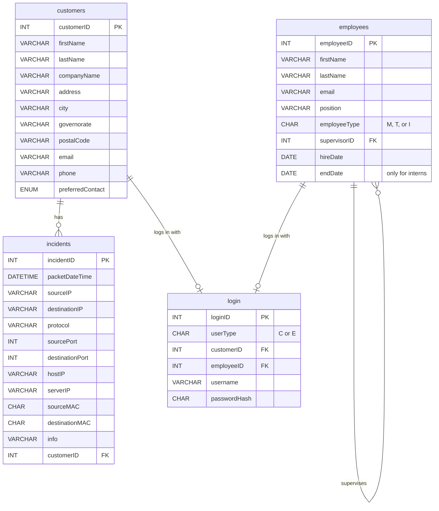

# HSHAM Database Management System

This is my capstone project for the **Managing Relational Databases** course. It is one of the five courses in the [Akamai Network Engineering Professional Certificate](https://www.coursera.org/professional-certificates/akamai-network-engineering).

In this course, we had to build a database for a fake company. I continued with the company I created in the earlier courses, **HSHAM for Tech Solutions**. It is an imaginary part of Akamai that helps small offices and home offices (SOHO) in Bahrain with cybersecurity. The database is the backend for the company website. It saves the customers, the employees, their logins, and security incidents that come from packet captures on the customers' devices.

## How this connects to my other courses

I tried to keep the same company in every course, so the project grows step by step:

1. **Operating System:** I set up a Linux file server with users, groups, permissions, and a backup script.
2. **Networking Fundamentals:** I designed the company network in Packet Tracer, with a LAN, a DMZ, and a web server.
3. **Databases (this project):** I built the database behind the website.

The employees in this database are the same people from my Linux file server: Mohammed and Abdullah are full-time staff, and Ahmed and Ali are interns.

## What I learned

- How to design tables with primary keys and foreign keys
- How to join tables with `INNER JOIN` and `LEFT JOIN`
- How to group and count data with `GROUP BY` and `HAVING`
- How to write subqueries
- How to work with dates (`DATEDIFF`, `CURDATE`) and text (`CONCAT_WS`)
- Why passwords should not be saved as plain text

## Database design

This diagram shows the four tables and how they are linked:



| Table | What it stores |
|---|---|
| `customers` | The small businesses that use our service. I used the Bahrain address style (building, road, block, governorate) instead of the US style. |
| `employees` | The company staff. Each person has a type: **M** for management, **T** for technician, or **I** for intern. Interns also have an end date, because their contract is only 6 months. |
| `login` | The usernames and passwords for both customers and employees. |
| `incidents` | The packets taken from customer captures. `hostIP` is the customer's device and `serverIP` is their router. |

### Some choices I made

**The login table has two foreign keys.** At first I used one column called `personID` for both customers and employees. Then I found a problem: one column cannot be a foreign key to two different tables. This means the database could not check if the person really exists. So I changed it to two columns, `customerID` and `employeeID`. Only one of them is filled in, and a `CHECK` rule makes sure it matches the user type.

**Passwords are hashed.** I save the passwords with `SHA2(..., 256)`, not as plain text. I know that a real website should use something stronger like bcrypt, but this was enough to show the idea.

**IP columns are `VARCHAR(45)`.** This is long enough for IPv6 addresses too, not only IPv4.

**Ports can be empty.** ICMP packets (like ping) do not use ports, so I allowed `NULL` there.

## How to run it

You need MySQL 8.0 or newer. I also tested it on MariaDB 10.11.

From the terminal:

```bash
mysql -u root -p < hsham_db.sql
```

Or open `hsham_db.sql` in MySQL Workbench and press the lightning button to run everything.

> **Note:** The script starts with `DROP DATABASE IF EXISTS HSHAM_DB`, so you can run it again many times without errors. But be careful, it will delete any database that already has this name.

## The queries

The course asked for seven queries:

| # | What it shows |
|---|---|
| 3A | Each customer's name, company, email, and username |
| 3B | All the employee information with their usernames |
| 3C | Every incident with the customer's name, company, IPs, and info |
| 3D | A mailing label for each customer, with every part on a new line |
| 3E | How many incidents each company has |
| 3F | The customers with the most and the fewest incidents |
| 3G | The date of each customer's last incident and how many days ago it was |

### Some results

**3E: incidents for each company**

| companyName | incidentCount |
|---|---|
| Desert IT Consulting | 4 |
| Bahrain Digital Services | 3 |
| Gulf Tech Solutions | 2 |

**3F: most and fewest incidents**

| firstName | lastName | companyName | incidentCount |
|---|---|---|---|
| Ahmed | Al-Mansoori | Gulf Tech Solutions | 2 |
| Mohammed | Al-Khalifa | Desert IT Consulting | 4 |

This one was the hardest for me. The instructor said the query must still be correct if we add more records later, so I could not just write the numbers 2 and 4. I used subqueries to find the `MAX` and `MIN` counts first, and then compared every customer with them.

**3D: mailing label**

```
Ahmed Al-Mansoori
Gulf Tech Solutions
Bldg 123, Road 1702, Block 317
Manama, Capital 317
Kingdom of Bahrain
```

**3G: days since the last incident** (the numbers change depending on the day you run it)

| customerID | lastIncidentDate | daysSinceLastIncident |
|---|---|---|
| 1 | 2025-07-09 | 486 |
| 2 | 2025-07-15 | 480 |
| 3 | 2025-07-21 | 474 |

## About the data

All the names, companies, emails, IP addresses, and MAC addresses are made up for this project. They are not real people or businesses.

## Author

**Hussain Ali Merza Shamlooh**
Computer Engineering student
